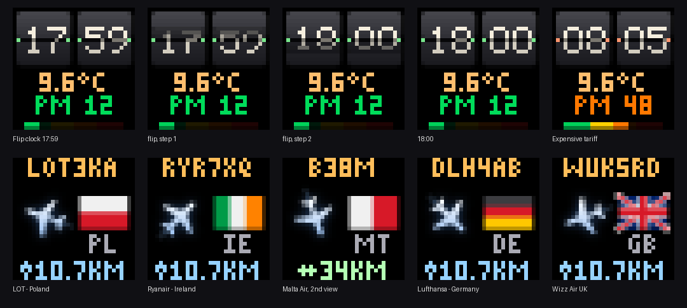
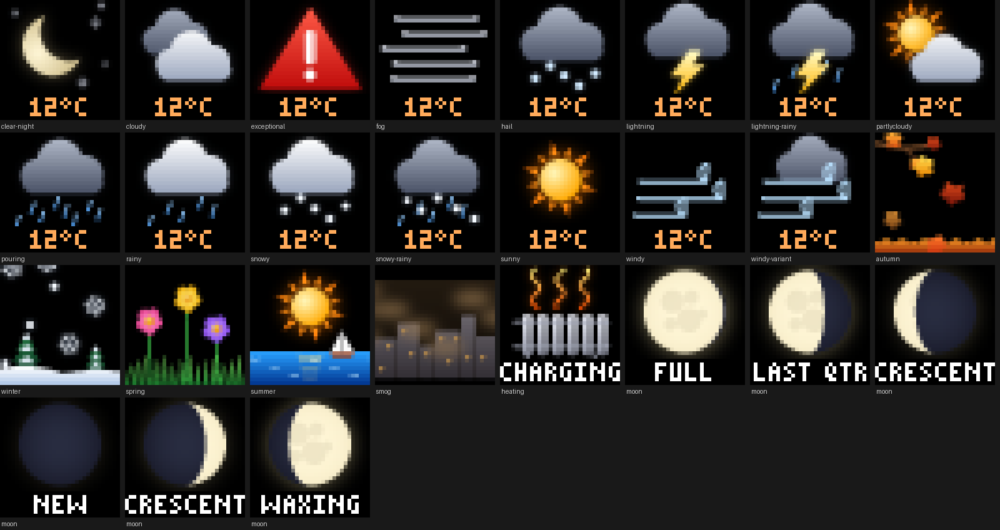
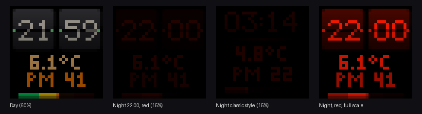
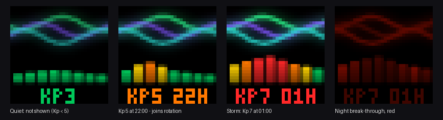

# BK-Light LED panel for Home Assistant

Control the **Action "BK-Light" 32×32 RGB LED pixel panel** (ACT1026, shows up in
Bluetooth as `LED_BLE_xxxxxxxx`) directly from Home Assistant, without the phone app.
Clocks, weather pictures, moon phase, the nearest aircraft from your ADS-B receiver,
an aurora forecast, alerts and your own images.



## Features

- **Local Bluetooth control**: through any Bluetooth adapter in Home Assistant,
  including **ESPHome Bluetooth proxies** (with `active: true`). No cloud, no app.
- **Clock faces**: a split-flap *flip clock* with flip animation, or large classic
  digits, with two text lines and a coloured level bar (e.g. PM2.5). An optional
  single-colour **tint** (e.g. red at night).
- **Built-in pictures**, drawn smoothly with gradients and glow: all Home Assistant
  weather states, the current **moon phase**, the **season** (falling leaves, snow,
  flowers, summer sea), **smog** and **heating** alerts. Most of them are animated.
- **Nearest aircraft**: reads `aircraft.json` from readsb / dump1090 / tar1090 and
  shows the closest plane pointing in its direction of flight, its callsign or type,
  altitude, distance and the **flag of its country of registration** (from the ICAO
  address).
- **Aurora forecast**: NOAA SWPC planetary Kp forecast for the next 24 hours as
  bars, with the expected peak.
- **Text, colours and your own images** (PNG/JPG/GIF, scaled to 32×32).
- **Smooth operation**: stays connected (so the panel never falls back to its stored
  animations), restores the picture after a dropped connection and never re-sends an
  identical frame.



## Requirements

- Home Assistant **2026.1 or newer** (developed and used on 2026.10).
- A Bluetooth adapter in Home Assistant **or** an ESPHome Bluetooth proxy within
  range of the panel, with active connections:

  ```yaml
  esp32_ble_tracker:
    scan_parameters:
      active: true
  bluetooth_proxy:
    active: true
  ```
- The panel's phone app must be **closed**: the panel accepts only one connection.

Tested with the ACT1026 32×32 panel. Other devices that also advertise as `LED_BLE_…`
(cheap LED strips and lamps use the same name) may use a different protocol and will
not work.

## Installation

### HACS (recommended)
1. HACS → ⋮ → **Custom repositories** → add
   `https://github.com/gatekeeper8/ha-bk-light-panel`, type **Integration**.
2. Install **BK-Light LED panel** and restart Home Assistant.

### Manual
Copy `custom_components/bk_light_panel` into your `config/custom_components/`
folder and restart Home Assistant.

## Setup

The panel is usually discovered automatically (Settings → Devices & services).
Otherwise: **Add integration → BK-Light LED panel**, pick the panel from the list, or
enter its Bluetooth address (Settings → Bluetooth → Advertisement monitor).

## Actions

With one panel the `panel` field can be left out; with several, give the panel's name
or address.

| Action | What it does |
|---|---|
| `bk_light_panel.show_clock` | Clock face: `style: flip` or `classic`, `line1`, `line2`, colours, `bar_value`, `tint`, `animate` |
| `bk_light_panel.show_text` | Centred text, up to 5 lines; `line_colors`, `scale` 1–4 |
| `bk_light_panel.show_icon` | Built-in picture (weather state, `moon`, `season`, `autumn`…`summer`, `smog`, `heating`), `caption`, `duration`, `frame_interval` |
| `bk_light_panel.show_nearest_aircraft` | Closest plane from your ADS-B `aircraft.json` (`url`, `max_distance`); returns the plane's data |
| `bk_light_panel.show_aurora` | NOAA Kp forecast for the next 24 h; `min_kp`, `show: false` = only return the data |
| `bk_light_panel.show_image` | Your own picture file (must be in an allowed folder, e.g. `/config/www`) |
| `bk_light_panel.fill` / `clear` | One colour / black |

Examples:

```yaml
action: bk_light_panel.show_clock
data:
  style: flip
  line1: "9.6°C"
  line2: "PM 12"
  bar_value: 12
  brightness: 60
```

```yaml
action: bk_light_panel.show_icon
data:
  icon: "{{ states('weather.forecast_home') }}"
  caption: "{{ state_attr('weather.forecast_home', 'temperature') | round }}°C"
  duration: 8
```

```yaml
action: bk_light_panel.show_nearest_aircraft
data:
  url: http://192.168.1.50:8080/data/aircraft.json
  max_distance: 80
response_variable: plane   # found, callsign, type, country, distance_km, altitude_m, ...
```

`frame_interval` (default 1.5 s) sets how often an animation frame is sent. The panel
confirms a frame on arrival but needs time to display it; sending much faster makes it
lag behind.

## Example dashboard on the panel

[`examples/led_panel.yaml`](examples/led_panel.yaml) is a complete package that turns
the panel into an info display:

- flip clock with outdoor temperature and PM2.5 every minute;
- a picture every 30 s (adjustable): weather, nearest plane, moon after dark, season,
  aurora when Kp ≥ 5, alerts while active;
- **night mode** (22:00 until 6:00 on working days / 7:00 on days off): red, dim,
  clock only, with an aurora break-through when Kp ≥ 6;
- an aurora forecast sensor and a phone notification when a visible aurora (Kp ≥ 6) is
  forecast for tonight.

Change the entity names at the top of the file to yours.




## Notes

- **Stored animations**: when nothing is connected, the panel plays the animations
  saved by its phone app. The integration therefore stays connected. To be safe,
  delete the saved programs in the app once.
- The moon phase names and the heating caption are currently in Polish (e.g. *PEŁNIA*,
  *ŁADUJE*). Translations are welcome.
- Debug logging:
  ```yaml
  logger:
    logs:
      custom_components.bk_light_panel: debug
  ```
  shows the connection, MTU and timing of every frame.

## Contributors

- [gatekeeper8](https://github.com/gatekeeper8): author and maintainer: idea, hardware,
  testing on a real panel.
- [Claude](https://claude.ai) (Anthropic's AI assistant): co-developer: integration
  code, graphics, tests and documentation, written together with the maintainer.

## Credits and licence

- Bluetooth protocol based on
  [Bk-Light-AppBypass](https://github.com/Pupariaa/Bk-Light-AppBypass) by Puparia,
  MIT License (see [`NOTICE.md`](custom_components/bk_light_panel/NOTICE.md)).
- Aurora data: [NOAA Space Weather Prediction Center](https://www.swpc.noaa.gov/).
- All pictures, fonts and flags are original artwork of this project.
- Not affiliated with Action, BK-Light or the panel's manufacturer.

MIT License, see [LICENSE](LICENSE).
