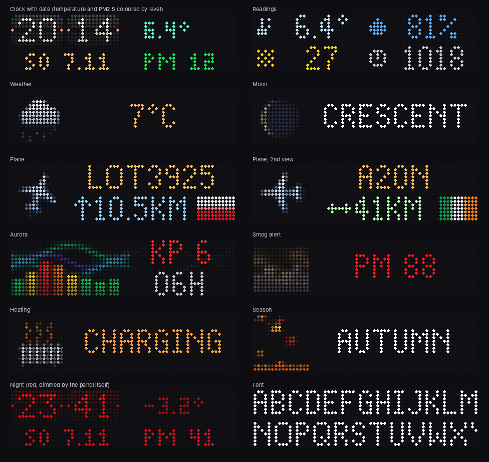
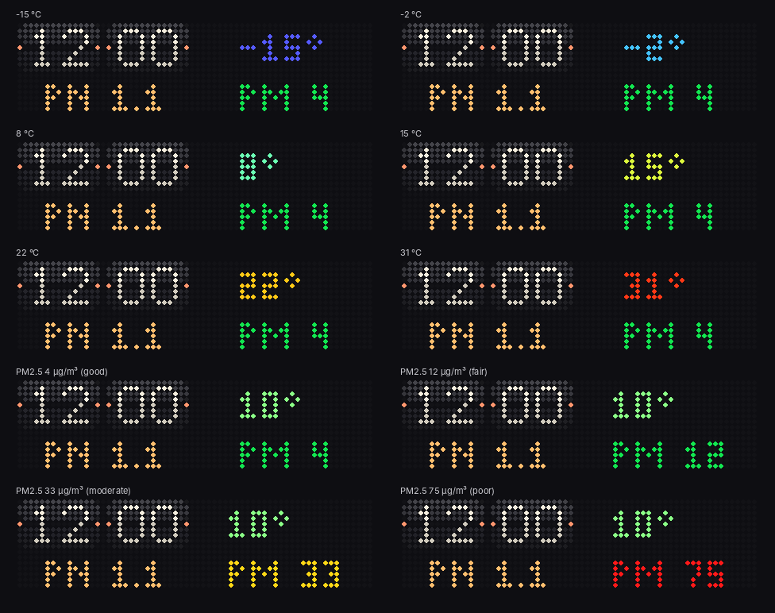
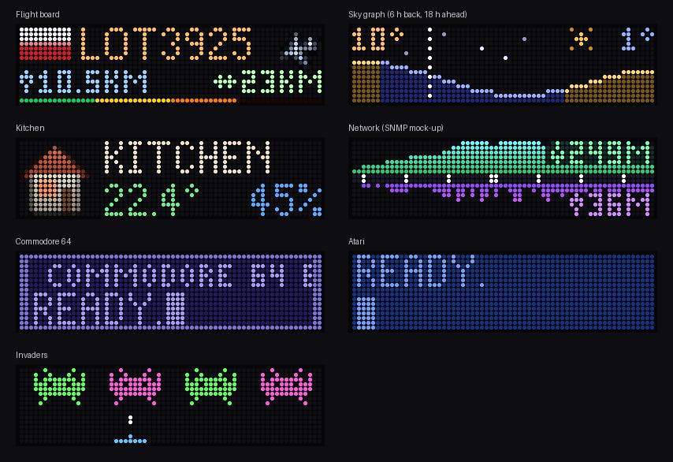
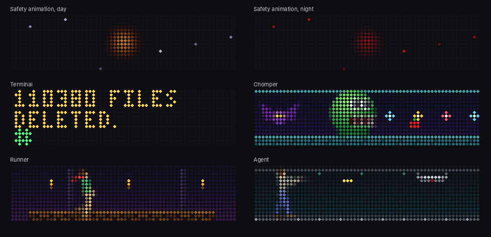

# BK-Light LED panel for Home Assistant

Control the **Action "BK-Light" RGB LED pixel panels**: the square 32×32 (ACT1026) and
the wide 64×16 (ACT1025 / ACT1033), which show up in Bluetooth as `LED_BLE_xxxxxxxx`,
directly from Home Assistant, without the phone app.
Clocks, weather pictures, moon phase, the nearest aircraft from your ADS-B receiver,
an aurora forecast, alerts and your own images.


## Features

- **Local Bluetooth control**: through any Bluetooth adapter in Home Assistant,
  including **ESPHome Bluetooth proxies** (with `active: true`). No cloud, no app.
- **Clock faces**: a split-flap *flip clock* with flip animation, or large classic
  digits, with two text lines and a coloured level bar (e.g. PM2.5). An optional
  single-colour **tint** (e.g. red at night).
- **Built-in pictures**, drawn smoothly with gradients and glow: all Home Assistant
  weather states, the current **moon phase**, the **season** (falling leaves, snow,
  flowers, summer sea), **smog** and **heating** alerts. Most of them are animated,
  and after sunset the sun is replaced by the moon ([night versions](images/night_pictures.png)).
- **Nearest aircraft**: reads `aircraft.json` from readsb / dump1090 / tar1090 and
  shows the closest plane pointing in its direction of flight, its callsign or type,
  altitude, distance and the **flag of its country of registration** (from the ICAO
  address).
- **Aurora forecast**: NOAA SWPC planetary Kp forecast for the next 24 hours as
  bars, with the expected peak, plus NOAA's OVATION nowcast for your own location
  (chance overhead and low in the north). The example combines it with cloud cover
  and darkness before alerting you.
- **Text, colours and your own images** (PNG/JPG/GIF, scaled to 32×32).
- **Smooth operation**: stays connected (so the panel never falls back to its stored
  animations), restores the picture after a dropped connection and never re-sends an
  identical frame.


Automatic captions (moon phase, "charging") follow your Home Assistant language:
English, or Polish ([Polish gallery](images/pictures_pl.png)). Force one with
`language: en` / `language: pl` in `show_icon`.

## Requirements

- Home Assistant **2026.1 or newer** (developed and used on 2026.10).
- A Bluetooth adapter in Home Assistant **or** an ESPHome Bluetooth proxy within
  range of the panel, with active connections:

  ```yaml
  esp32_ble_tracker:
    scan_parameters:
      active: true
  bluetooth_proxy:
    active: true
  ```
- The panel's phone app must be **closed**: the panel accepts only one connection.

Tested with the ACT1026 (32×32) and ACT1033 (64×16) panels. Other devices that also advertise as `LED_BLE_…`
(cheap LED strips and lamps use the same name) may use a different protocol and will
not work.

## Installation

### HACS (recommended)
1. HACS → ⋮ → **Custom repositories** → add
   `https://github.com/gatekeeper8/ha-bk-light-panel`, type **Integration**.
2. Install **BK-Light LED panel** and restart Home Assistant.

### Manual
Copy `custom_components/bk_light_panel` into your `config/custom_components/`
folder and restart Home Assistant.

## Setup

The panel is usually discovered automatically (Settings → Devices & services).
Otherwise: **Add integration → BK-Light LED panel**, pick the panel from the list, or
enter its Bluetooth address (Settings → Bluetooth → Advertisement monitor).

## Wide 64×16 panels

The integration reads the panel's size from its first answer, so the same actions work
on both. On a 64×16 panel the clock sits on the left with the two text lines and the
level bar beside it, pictures get their caption beside them, the nearest plane becomes a
flight-board line (plane on its track, flag, callsign / type, altitude / distance) and
the aurora shows the Kp bars with the peak hour. With several panels, name the one you
mean with `panel:`.

[`examples/led_panel_wide.yaml`](examples/led_panel_wide.yaml) turns a 64×16 panel into a
second clock with the date, alternating every minute with the outdoor readings and a
rotating picture (weather, forecast, sky graph, flight board, aurora, smog, moon, heating,
now and then a retro screen, and your own GIF).

- **Clock with date**: flip cards with the day and date under them. The outdoor
  temperature and PM2.5 go beside them in the same small font, level with the time and
  the date. The example colours the temperature on a smooth scale (violet-blue in frost →
  cyan → green → yellow → orange → red in heat). PM2.5 follows the bands of the
  [European Air Quality Index](https://airindex.eea.europa.eu/AQI): green up to 15 µg/m³
  (good / fair), yellow 16–50 (moderate), red from 51 (poor or worse).
- **Night**: the red night screen is drawn at full strength and the panel dims itself
  (`set_brightness`), so dim red stays readable.
- **Your own GIF**: put a 64×16 GIF in `/config/www/` and its path into the helper
  "LED panel 2 - own GIF". It joins the picture rotation, stored in panel slot 3: uploaded
  once, then only switched. Use bright colours on black: the panel shows stored GIFs with
  gamma 2.2, so dark colours get darker.





Retro screens and the safety animation are stored in the panel and played by the panel
itself, smoothly and without Bluetooth traffic:



## Actions

With one panel the `panel` field can be left out; with several, give the panel's name
or address.

| Action | What it does |
|---|---|
| `bk_light_panel.show_clock` | Clock face: `style: flip` or `classic`, `line1`, `line2`, colours, `bar_value`, `tint`, `animate` |
| `bk_light_panel.show_text` | Centred text, up to 5 lines; `line_colors`, `scale` 1–4 |
| `bk_light_panel.show_icon` | Built-in picture (weather state, `moon`, `season`, `autumn`…`summer`, `smog`, `heating`), `caption`, `duration`, `frame_interval` |
| `bk_light_panel.show_nearest_aircraft` | Closest plane from your ADS-B `aircraft.json` (`url`, `max_distance`); returns the plane's data |
| `bk_light_panel.show_aurora` | NOAA Kp forecast for the next 24 h; `min_kp`, `show: false` = only return the data |
| `bk_light_panel.show_readings` | Up to four readings with icons, coloured by level: `temperature`, `humidity`, `pm25`, `pm10`, `pressure` |
| `bk_light_panel.show_forecast` | Weather in a few hours and tomorrow: picture, hour / weekday, temperature |
| `bk_light_panel.show_sky_graph` | 64×16: 24 h of temperature (history + hourly forecast), day and night marked |
| `bk_light_panel.show_room` | 64×16: a room's name, temperature and humidity |
| `bk_light_panel.show_traffic` | 64×16: network download / upload of the last minutes, from data-rate sensors |
| `bk_light_panel.show_retro` | 64×16: retro screens and little animations (8-bit start-up screens, aliens, a root prompt running `rm -rf /*`, a maze chomper, a runner, an agent vs a drone). Played from the panel's memory: each is uploaded once to its own slot (23–29), then only the playlist switches; `mode: live` streams frames instead |
| `bk_light_panel.play_animation` | Store an animation (built-in or your GIF) in a panel slot; the panel plays it smoothly by itself |
| `bk_light_panel.set_playlist` | Which stored slots play in turn (also while disconnected) |
| `bk_light_panel.set_safety_animation` | A calm breathing animation (or `style: black`) stored in the panel and put in its playlist, so a dropped connection shows it; `tint` e.g. red at night |
| `bk_light_panel.set_brightness` | The panel's own brightness, 0–100 % (keeps full colour) |
| `bk_light_panel.show_image` | Your own picture file (must be in an allowed folder, e.g. `/config/www`) |
| `bk_light_panel.fill` / `clear` | One colour / black |

Examples:

```yaml
action: bk_light_panel.show_clock
data:
  style: flip
  line1: "9.6°C"
  line2: "PM 12"
  bar_value: 12
  brightness: 60
```

```yaml
action: bk_light_panel.show_icon
data:
  icon: "{{ states('weather.forecast_home') }}"
  caption: "{{ state_attr('weather.forecast_home', 'temperature') | round }}°C"
  duration: 8
```

```yaml
action: bk_light_panel.show_nearest_aircraft
data:
  url: http://adsb-receiver.local:8080/data/aircraft.json
  max_distance: 80
response_variable: plane   # found, callsign, type, country, distance_km, altitude_m, ...
```

`frame_interval` (default 1.5 s) sets how often an animation frame is sent. The panel
confirms a frame on arrival but needs time to display it; sending much faster makes it
lag behind.

## Example dashboard on the panel

[`examples/led_panel.yaml`](examples/led_panel.yaml) is a complete package that turns
the panel into an info display:

- flip clock with outdoor temperature and PM2.5 every minute;
- a picture every 30 s (adjustable): weather, nearest plane, moon after dark, season,
  aurora when Kp ≥ 5, alerts while active;
- **night mode** (22:00 until 6:00 on working days / 7:00 on days off): red, dim,
  clock only, with an aurora break-through when Kp ≥ 6;
- an aurora forecast sensor and a phone notification when a visible aurora (Kp ≥ 6) is
  forecast for tonight.

- **day and night brightness sliders** (helpers), applied to the panel immediately.

Change the entity names at the top of the file to yours.

At night the red clock is drawn at full strength and the panel dims itself with its own
brightness (`set_brightness`, the night slider), so even low values stay readable; by
day the panel is set back to 100 % and the day slider dims the pictures. If the screen
stays dark after installing the package, check the two brightness sliders. After a YAML reload (instead of a restart)
they can start at their minimum values.


## Notes

- **Panel slots used by the integration**: 20–22 for the safety animation (day, night,
  black) and 23–29 for the retro screens (atari, c64, invaders, terminal, chomper,
  runner, agent). Which GIF is in which slot is remembered across restarts (by CRC), so
  each is uploaded only once. If you change animations with the phone app, add
  `force: true` once. A GIF the panel does not confirm is streamed live instead and not
  tried again for 6 hours.
- **Stored animations**: when nothing is connected, the panel plays the animations in
  its playlist, by default the ones saved by its phone app. The integration therefore
  stays connected, and `set_safety_animation` replaces the playlist with a calm
  animation of its own (the example packages switch it between day, red night and
  black when the screen is off), so a dropped connection never brings the phone app's
  programs back.
- Captions exist in English and Polish. More languages are welcome: add them to
  `MOON_NAMES`, `CHARGING` and `SEASON_NAMES` in `icons.py` (every word must fit in
  32 pixels; a test checks it).
- Debug logging:
  ```yaml
  logger:
    logs:
      custom_components.bk_light_panel: debug
  ```
  shows the connection, MTU and timing of every frame.

## Contributors

- [gatekeeper8](https://github.com/gatekeeper8): author and maintainer: idea, hardware,
  testing on a real panel.
- [Claude](https://claude.ai) (Anthropic's AI assistant): co-developer: integration
  code, graphics, tests and documentation, written together with the maintainer.

## Credits and licence

- Bluetooth protocol based on
  [Bk-Light-AppBypass](https://github.com/Pupariaa/Bk-Light-AppBypass) by Puparia,
  MIT License (see [`NOTICE.md`](custom_components/bk_light_panel/NOTICE.md)).
- Aurora data: [NOAA Space Weather Prediction Center](https://www.swpc.noaa.gov/).
- All pictures, fonts and flags are original artwork of this project.
- Not affiliated with Action, BK-Light or the panel's manufacturer.

MIT License, see [LICENSE](LICENSE).
